# ☕ KahveCell

Telefon numarasıyla giriş, aylık kahve aboneliği, konuma göre kahve dükkânı keşfi ve **imzalı QR kodla** sipariş teslimi olan dijital kahve abonelik platformu.

Kullanıcı bir paket seçip (simüle edilmiş) kartla öder, haritadan yakındaki dükkânı bulur, kahvesini özelleştirip sipariş verir ve her siparişte aboneliğinden 1 kahve hakkı düşer. Dükkân siparişi hazırlar ve müşterinin QR kodunu **kamerayla okutarak** teslim eder.

> Bu proje, **Turkcell Geleceği Yazanlar – Prompt Mühendisliği eğitimi** kapsamında verilen "KahveCell" case çalışması için, yapay zekâ (Claude) ile birlikte geliştirilmiştir. Ayrıntı için [Yapay zekâ ile geliştirme](#yapay-zekâ-ile-geliştirme) bölümüne bakın.

## Ekran görüntüleri

Aşağıdaki görüntüler, uygulamanın gerçek bir tarayıcıda (Edge) baştan sona gezilmesiyle alınmıştır. Dükkân sahibi tarafındaki QR okutma adımı, müşterinin gerçek QR kodunu gösteren sahte bir kamerayla denenmiştir.

| | |
|:--:|:--:|
| 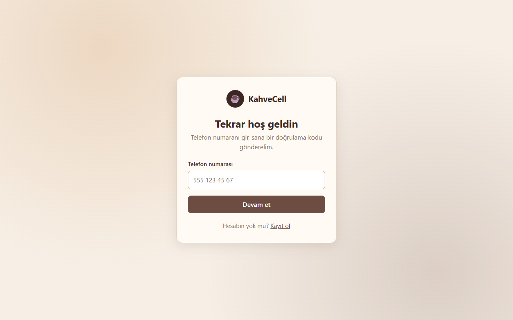 | 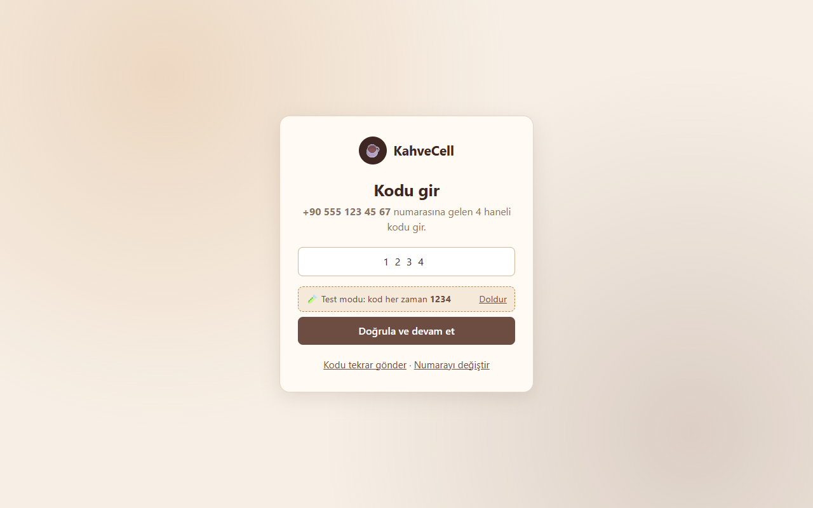 |
| Giriş | Kod doğrulama (test modu notu) |
| 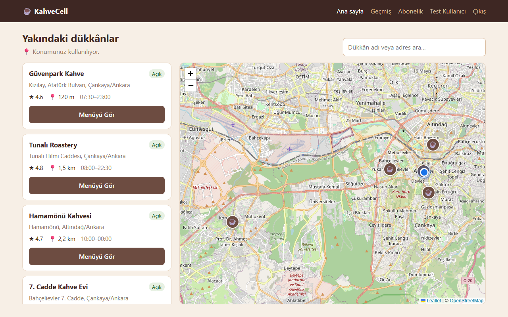 | 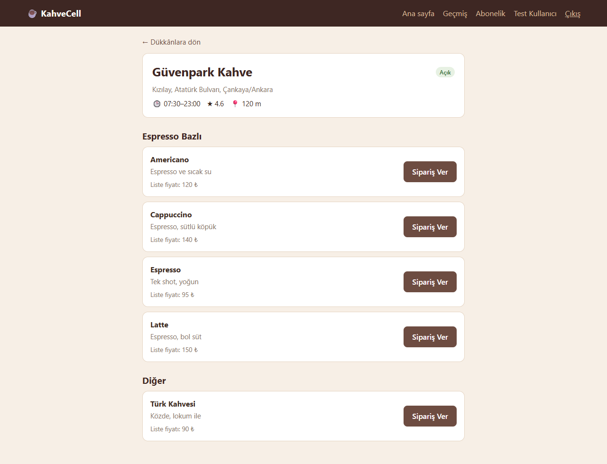 |
| Ana sayfa: liste, harita ve konumum | Dükkân detayı ve kategorili menü |
| 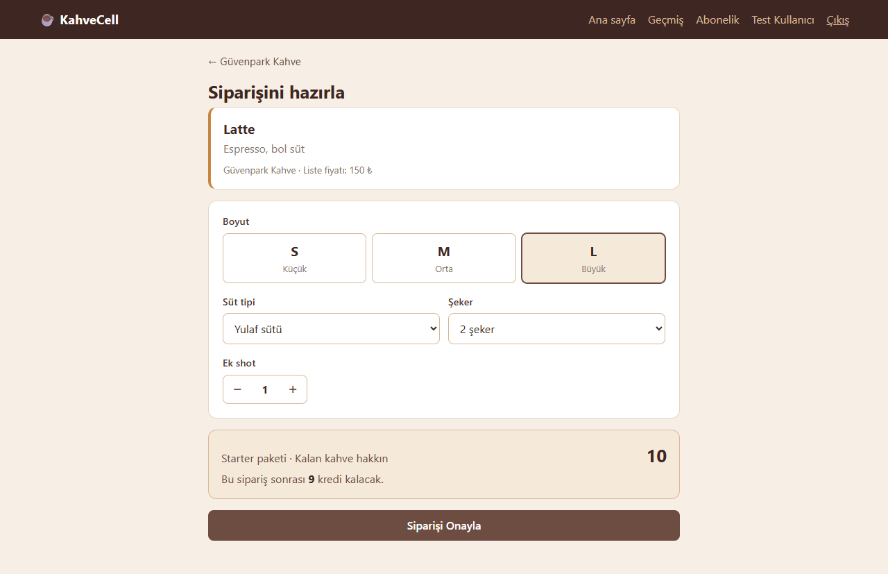 | 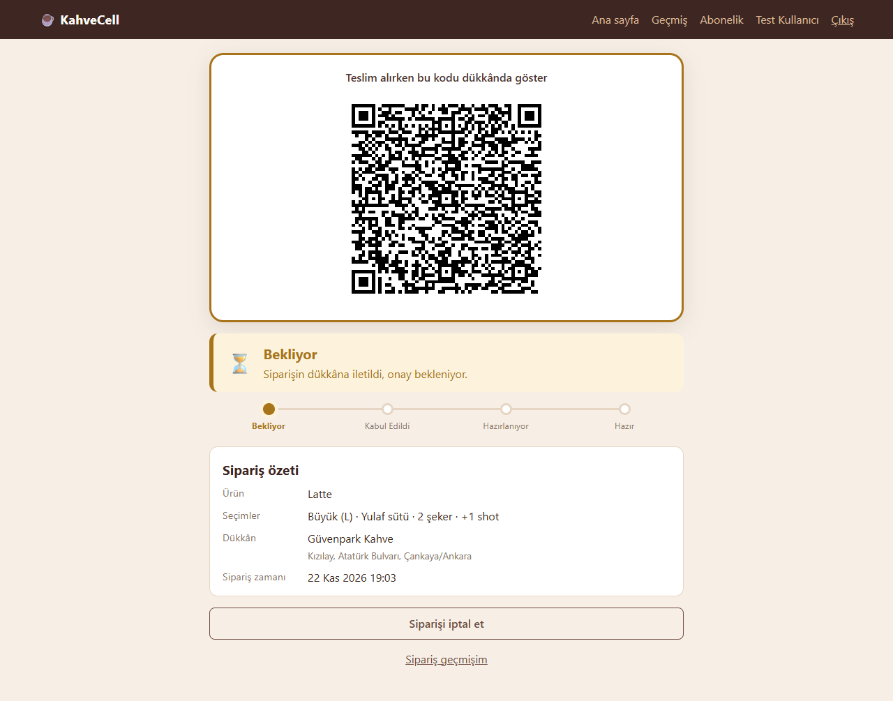 |
| Sipariş özelleştirme ve kalan kredi | Sipariş sonrası QR kod (Bekliyor) |
| 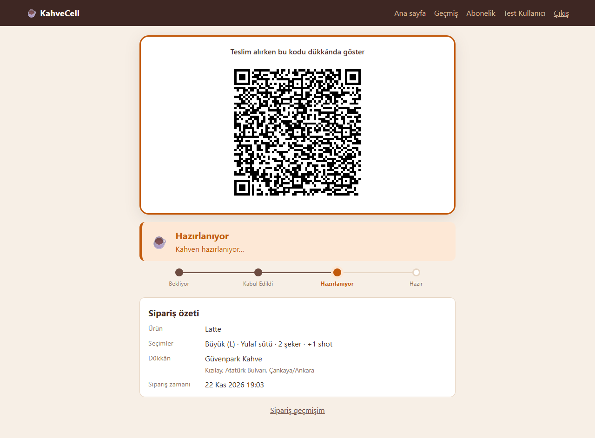 | 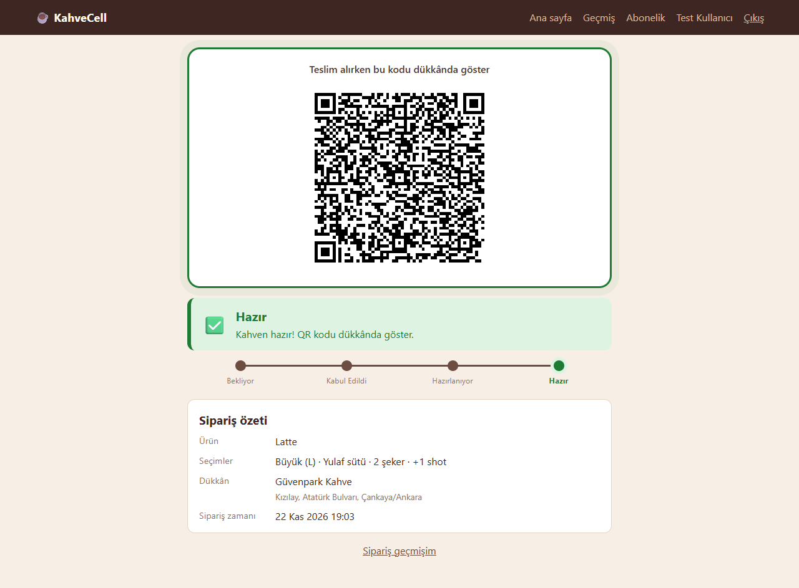 |
| Durum canlı değişir: Hazırlanıyor | Hazır (yeşil, QR kod yanıp söner) |
| 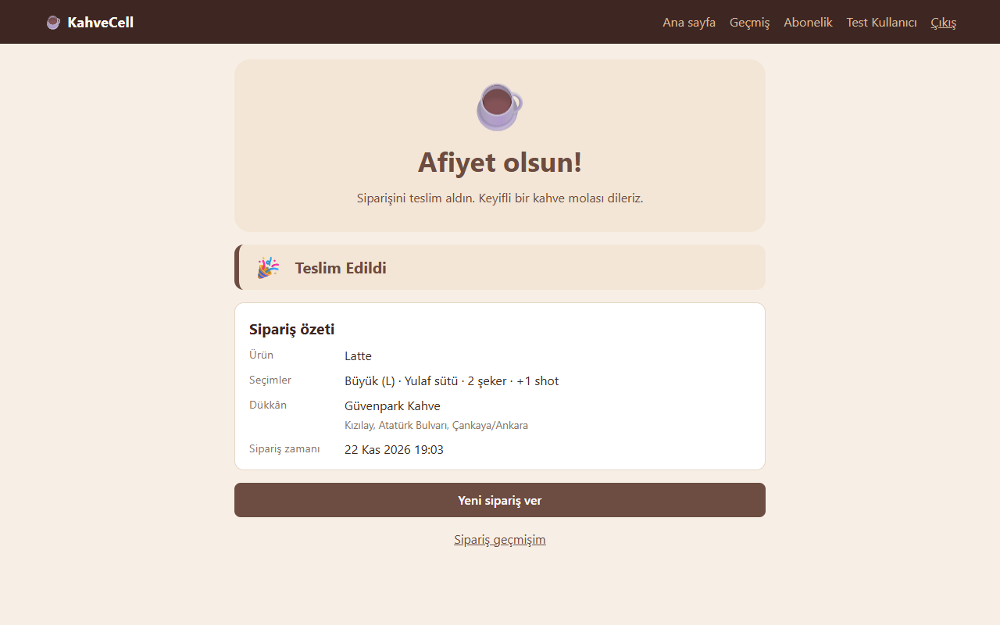 | 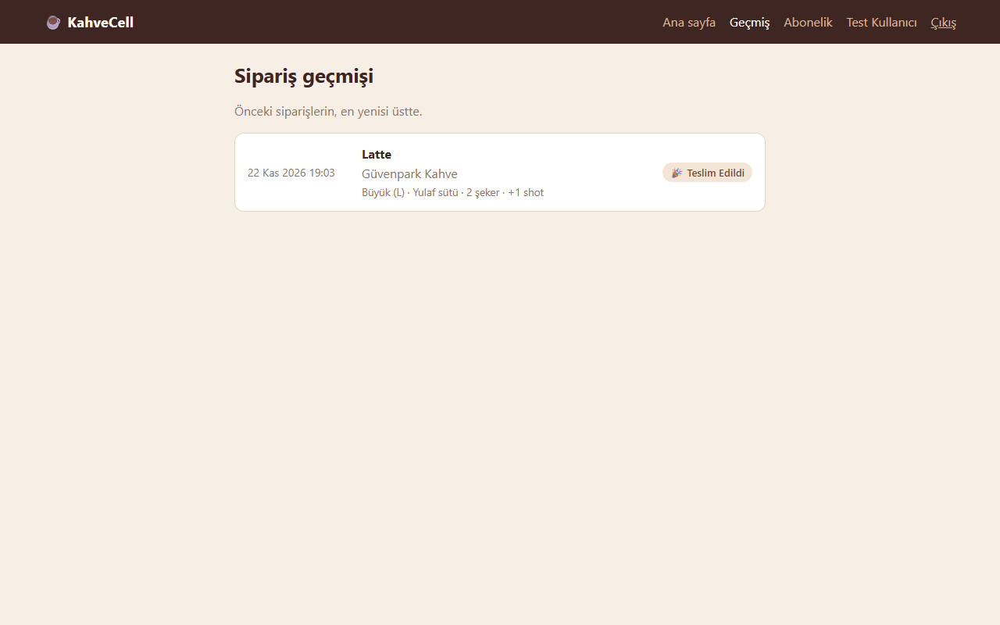 |
| Teslim sonrası "Afiyet olsun" | Sipariş geçmişi |
| 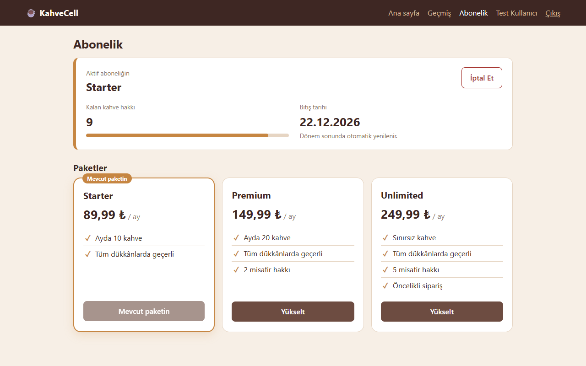 | 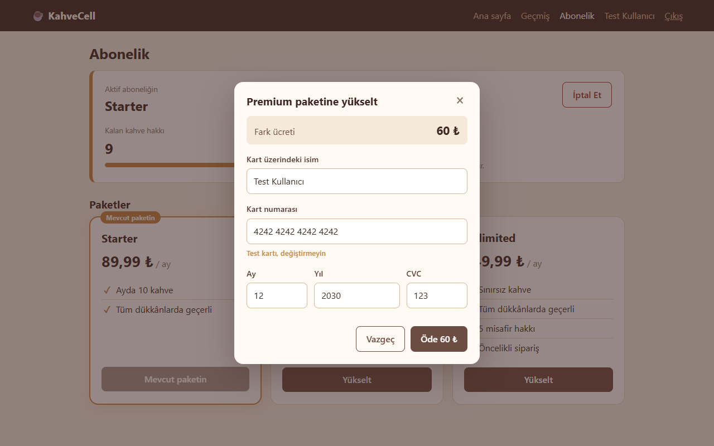 |
| Abonelik ve paketler | Kartla ödeme penceresi |
| 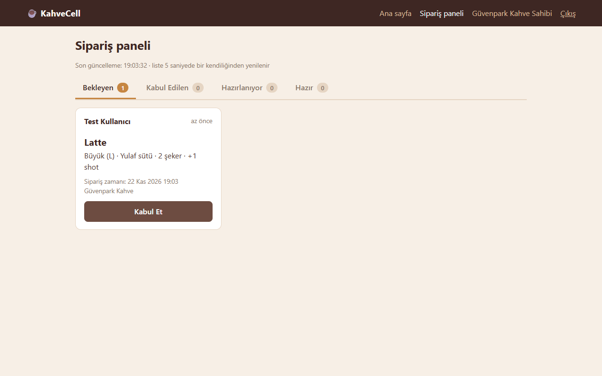 | 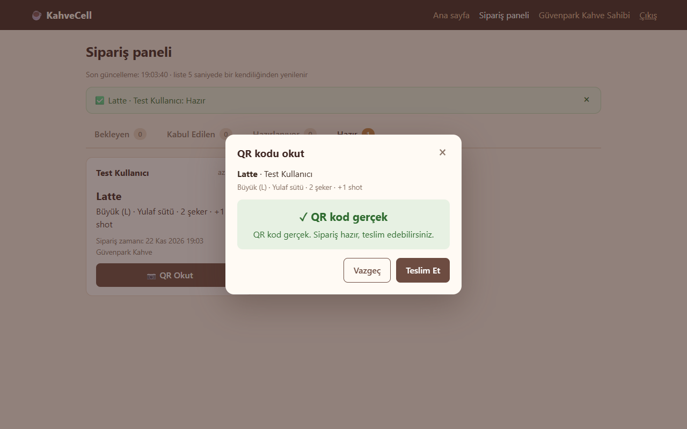 |
| Dükkân sahibi paneli | Kamerayla okutulan QR doğrulandı |

## İçindekiler

- [Ekran görüntüleri](#ekran-görüntüleri)
- [Özellikler](#özellikler)
- [Teknolojiler](#teknolojiler)
- [Hızlı başlangıç](#hızlı-başlangıç)
- [Test hesapları ve demo akışı](#test-hesapları-ve-demo-akışı)
- [Proje yapısı](#proje-yapısı)
- [API özeti](#api-özeti)
- [Veritabanı](#veritabanı)
- [Mimari kararlar](#mimari-kararlar)
- [Testler](#testler)
- [Bilinen sınırlamalar](#bilinen-sınırlamalar)
- [Yapay zekâ ile geliştirme](#yapay-zekâ-ile-geliştirme)

## Özellikler

**Müşteri**
- GSM numarası ile kayıt ve giriş, SMS OTP doğrulama (simülasyon), JWT + yenileme (refresh) token
- 3 abonelik paketi (Starter, Premium, Unlimited): satın alma, yükseltme (fark ücreti), düşürme, iptal, aylık yenileme
- Kartla ödeme akışı (simülasyon) ve ödeme geçmişi
- Tarayıcı konumuna göre yakındaki dükkânlar: harita (Leaflet), mesafeye göre liste, isim/adres araması
- Dükkân detayı ve kategorilere ayrılmış menü
- Sipariş özelleştirme: boyut, süt tipi, şeker, ek shot
- Kalan kahve hakkı bilgisi, hak bitince veya abonelik yokken sipariş engeli
- Her sipariş için **imzalı QR kod** ve **canlı sipariş takibi** (durum her birkaç saniyede güncellenir)
- Sipariş geçmişi, iptal (kahve hakkı iade edilir), aynı siparişi tekrar verme

**Dükkân sahibi**
- Ayrı sipariş paneli: Bekleyen / Kabul Edilen / Hazırlanıyor / Hazır sekmeleri, otomatik yenilenen liste
- Durum ilerletme: Kabul Et → Hazırlamaya Başla → Hazır
- **Kamera ile QR okutma**: QR'ın gerçekliği sunucuda doğrulanır, ancak ondan sonra teslim edilebilir
- Öncelikli paket (Unlimited) müşterileri kuyrukta öne çıkar

**Güvenlik**
- Rol bazlı erişim (müşteri, dükkân sahibi, admin), yetki kontrolü backend'de
- QR sahteciliğine karşı HMAC-SHA256 imza; teslim edilmiş QR tekrar kullanılamaz
- Hak düşümü tek atomik sorguyla yapılır (aynı anda iki istek son hakkı iki kez harcayamaz)
- Kartın tamamı hiçbir yere kaydedilmez veya loglanmaz, yalnızca son 4 hane tutulur

## Teknolojiler

| Katman | Teknoloji |
|---|---|
| Backend | Python 3.11+, FastAPI, SQLAlchemy 2, Pydantic 2, PyJWT |
| Veritabanı | SQLite |
| Frontend | React 19, Vite, React Router, Zustand, Axios |
| Harita | Leaflet / react-leaflet (OpenStreetMap) |
| QR | `qrcode` (üretim, backend), `jsQR` (kamera ile okuma, frontend) |
| Test | pytest (backend) |

## Hızlı başlangıç

Gerekenler: **Python 3.11 veya üstü** (geliştirme ve testler Python 3.14 ile yapıldı), **Node.js 18 veya üstü**. İki sunucu aynı anda çalışmalıdır (iki ayrı terminal).

### 1. Backend (http://localhost:8000)

**Windows (PowerShell)**
```powershell
cd backend
py -m venv .venv
.venv\Scripts\Activate.ps1
pip install -r requirements.txt
python seed.py
uvicorn app.main:app --reload --reload-dir app --port 8000
```

**macOS / Linux**
```bash
cd backend
python3 -m venv .venv
source .venv/bin/activate
pip install -r requirements.txt
python seed.py
uvicorn app.main:app --reload --reload-dir app --port 8000
```

- `python seed.py` örnek veriyi yükler (3 paket, Ankara'dan 5 dükkân, 25 ürün, test hesapları). Tekrar çalıştırmak güvenlidir; veriyi sıfırlamak için `python seed.py --reset`.
- Veritabanı dosyası (`backend/kahvecell.db`) ilk açılışta otomatik oluşur.
- API dokümantasyonu (Swagger): http://localhost:8000/docs

### 2. Frontend (http://localhost:5173)

```bash
cd frontend
npm install
npm run dev
```

Frontend backend'e `http://localhost:8000` adresinden bağlanır. Değiştirmek için `frontend/.env.example` dosyasını `.env` olarak kopyalayıp `VITE_API_URL` değerini düzenleyin. Frontend portu **5173** olmalıdır (backend'in CORS izni bu adrese verilmiştir).

### Ayarlar (isteğe bağlı)

`backend/.env.example` dosyasını `.env` olarak kopyalayarak veritabanı adresi, token süreleri, gizli anahtar ve frontend'in izinli adresini (`CORS_ORIGINS`) değiştirebilirsiniz. **Canlıya çıkarken `SECRET_KEY` mutlaka değiştirilmelidir**; varsayılan değer yalnızca geliştirme içindir.

## Test hesapları ve demo akışı

Simülasyonda SMS gönderilmez, **doğrulama kodu her zaman `1234`**'tür.

| Rol | Telefon | Not |
|---|---|---|
| Müşteri | `5551234567` | Aktif Starter aboneliği var |
| Dükkân sahibi | `5559990001` | Güvenpark Kahve'nin paneli |
| Admin | `5550000000` | Kullanıcı listesi (yalnızca API) |

**Ödeme simülasyonu:** `4242 4242 4242 4242` her zaman başarılı, `4000 0000 0000 0002` her zaman başarısızdır.

**Önerilen demo akışı** (iki ayrı tarayıcı veya gizli pencere gerekir, çünkü oturum tarayıcıda tutulur):

1. Müşteri olarak giriş yap → ana sayfada bir dükkânın **Menüyü Gör** butonuna bas → bir ürün için **Sipariş Ver** → seçenekleri belirle ve onayla. QR sayfası açılır.
2. Dükkân sahibi olarak giriş yap (otomatik olarak `/panel` açılır) → siparişi **Kabul Et**, **Hazırlamaya Başla**, **Hazır** ile ilerlet. Müşterinin ekranında durum ve renk canlı değişir.
3. **Hazır** sekmesinde **QR Okut** → müşterinin QR'ını kameraya göster (kamera yoksa içeriği elle yapıştırabilirsin) → **Teslim Et**. Müşteri ekranında "Afiyet olsun!" çıkar.
4. Abonelik sayfasında paket yükseltme, düşürme ve iptali dene.

## Proje yapısı

```
KahveCell/
├── backend/                  FastAPI uygulaması
│   ├── app/
│   │   ├── api/v1/           Endpoint'ler (auth, users, subscriptions, payments, shops, orders)
│   │   ├── services/         İş mantığı (abonelik, ödeme, sipariş, QR)
│   │   ├── repositories/     Veritabanı sorguları
│   │   ├── models/           SQLAlchemy tabloları
│   │   ├── schemas/          İstek/cevap şemaları (Pydantic)
│   │   └── core/             Ayarlar, güvenlik (JWT), konum (Haversine), hata yönetimi
│   ├── tests/                111 otomatik test
│   ├── seed.py               Örnek veri yükleyici
│   └── requirements.txt
└── frontend/                 React uygulaması
    └── src/
        ├── pages/            Sayfalar (giriş, ana sayfa, dükkân, sipariş, QR, geçmiş, abonelik, panel)
        ├── components/       Tekrar kullanılan parçalar (harita, modal, QR okuyucu, kartlar)
        ├── api/              Backend istekleri
        ├── store/            Oturum ve konum durumu (Zustand)
        └── utils/            Yardımcı fonksiyonlar
```

## API özeti

Tüm cevaplar `{ "success": bool, "data": ..., "error": { "code", "message", "details" } }` biçimindedir. Ön ek: `/api/v1`. Etkileşimli dokümantasyon: http://localhost:8000/docs (sağ üstteki **Authorize** ile token girilir).

| Grup | Endpoint'ler |
|---|---|
| Kimlik | `POST /auth/register`, `/auth/login`, `/auth/verify-otp`, `/auth/refresh`, `/auth/logout` |
| Kullanıcı | `GET`/`PATCH /users/me`, `GET /users` (admin) |
| Abonelik | `GET /subscriptions/plans`, `POST /subscriptions`, `GET`/`PATCH`/`DELETE /subscriptions/me` |
| Ödeme | `GET /payments/me` |
| Dükkân | `GET /shops` (konum, arama, filtre), `GET /shops/{id}`, `GET /shops/{id}/menu` |
| Sipariş | `POST /orders`, `GET /orders/history`, `GET /orders/shop`, `GET /orders/{id}`, `GET /orders/{id}/qr`, `PATCH /orders/{id}/status`, `POST /orders/verify-qr`, `POST /orders/{id}/cancel`, `POST /orders/{id}/reorder` |

## Veritabanı

SQLite, 8 tablo, yabancı anahtar bütünlüğü açık:

| Tablo | İçerik |
|---|---|
| `users` | Telefon, ad, e-posta, rol, kahve tercihleri |
| `plans` | Paketler: fiyat, aylık kahve hakkı, misafir hakkı, öncelik |
| `subscriptions` | Kullanıcının paketi, kalan hak, durum, bitiş tarihi (kullanıcı başına en fazla 1 aktif abonelik) |
| `payments` | Başarılı ve başarısız tüm ödeme denemeleri |
| `shops` | Dükkân bilgisi, enlem/boylam (indeksli), çalışma saatleri, puan |
| `products` | Dükkân menüsündeki ürünler |
| `orders` | Sipariş, özelleştirmeler ve durum (durum makinesi ile yönetilir) |
| `refresh_tokens` | Çıkışta iptal edilebilen yenileme biletleri |

## Mimari kararlar

- **Katmanlı yapı:** Endpoint → servis → repository. İş kuralları (hak düşümü, durum geçişleri, QR doğrulama) servis katmanında toplanır.
- **SQLite:** Kurulum gerektirmediği ve tek dosya olduğu için eğitim ve demo amacına uygundur. Konum sorgusu için önce indeksli enlem/boylam kutusuyla ön eleme, sonra Haversine formülüyle kesin mesafe hesabı yapılır.
- **Telefon + OTP kimlik doğrulaması:** Case dokümanı şifre yerine SMS kodunu öngörür; bu yüzden şifre alanı yoktur. Kısa ömürlü access token (30 dk) ve iptal edilebilen refresh token (7 gün, her yenilemede yenisiyle değiştirilir, eski token tekrar kullanılırsa tüm oturumlar kapanır).
- **QR imzası:** QR içeriği case'deki JSON'dur (`order_id`, `user_id`, `shop_id`, `created_at`, `signature`). `signature`, bu alanların sunucudaki gizli anahtarla HMAC-SHA256 imzasıdır. Teslim için QR sunucuda doğrulanmadan sipariş `Teslim edildi` olamaz.
- **Canlı takip için polling:** Sipariş durumu birkaç saniyede bir sorgulanır. Basit ve güvenilirdir; WebSocket/SSE sonraki iyileştirmedir.
- **Konum:** Tarayıcı konumu tek sefer istenir ve saklanır. İzin verilmezse Ankara Kızılay varsayılır.

## Testler

```bash
cd backend
pytest
```

111 test; kimlik doğrulama, rol yetkileri, abonelik ve ödeme senaryoları, konum/arama, sipariş akışı, hak düşümü, QR sahteciliği ve durum makinesini kapsar. Testler geçici bir veritabanı kullanır, gerçek veriye dokunmaz.

Frontend için `npm run lint` ve `npm run build` kullanılabilir. Frontend'in otomatik testi yoktur.

## Bilinen sınırlamalar

- Ödeme ve SMS **simülasyondur**; gerçek bir ödeme veya SMS sağlayıcısına bağlı değildir.
- Veritabanı şeması otomatik oluşturulur ancak **migration (Alembic) kurulu değildir**; şema değişiklikleri için veritabanını yeniden oluşturmak gerekir. Ürün kategorisi bu yüzden ürün adından türetilir.
- Rate limiting ve OTP deneme sınırı yoktur.
- Kamera ile QR okuma yalnızca güvenli bağlamda (`localhost` veya `https`) çalışır.
- Docker, CI/CD ve push bildirimi bulunmuyor.
- Dükkân sahibi paneli siparişi reddetme butonu içermiyor (backend destekliyor).
- Dükkân saatleri sipariş verirken denetlenmez.

## Yapay zekâ ile geliştirme

Proje, **Turkcell Geleceği Yazanlar – Prompt Mühendisliği eğitimi** kapsamında, kod bilgisi olmayan bir geliştiricinin yapay zekâ (Claude, Anthropic) ile birlikte bir yazılım ürününü uçtan uca inşa etmesi hedefiyle hazırlanmıştır. Teknoloji seçimleri, kapsam ve gereksinim kararları geliştirici tarafından verilmiş; kod, yapay zekâ ile adım adım, her adımda testlerle doğrulanarak yazılmıştır.
